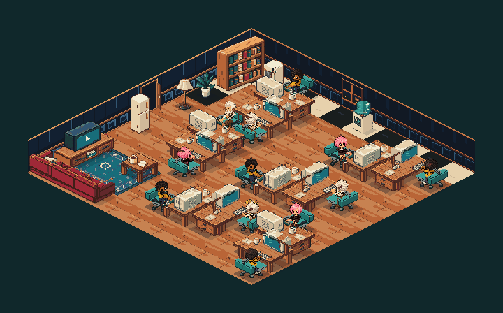
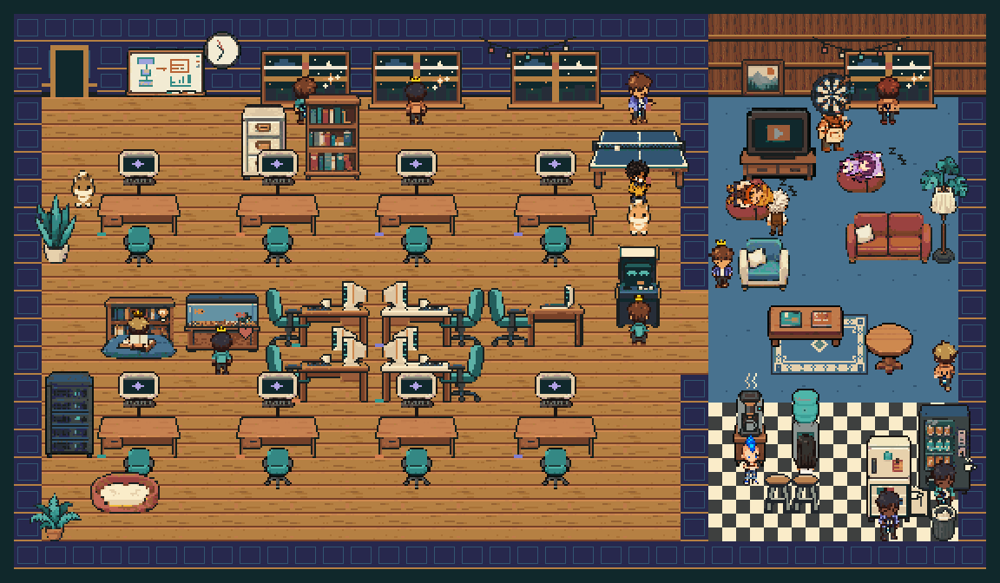
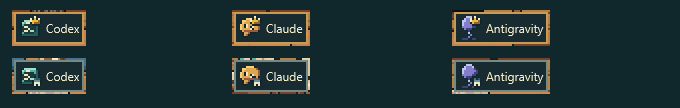

[English](README.md) | [한국어](README.ko.md)

# Vibedotcom

Vibedotcom은 Windows에서 최근 Codex, Claude Code, Antigravity 세션을 작은 픽셀 사무실로 보여준다. 캐릭터는 일하고, 기다리고, 보고서를 전달하거나 쉰다. 마우스를 올리면 세션 정보가 보이고, 평면 화면은 확인된 부모 세션을 선으로 연결한다. 세션을 관찰할 뿐 작업을 배정하거나 에이전트를 조작하지 않는다. 각 도구 소유자와 제휴하거나 승인을 받은 프로젝트는 아니다.

## 기능과 현재 상태

2026-10-04 소스와 문서 기준이다.

- **평면·아이소 WPF 화면.** 기본값은 flat이다. `--view iso`, 설정 `view:"iso"`, 사무실·트레이의 **Isometric view** 메뉴로 바꾼다. 아이소 엔진과 내장 팩은 10×10 방, 12석, 캐릭터 3종, 앉아서 일하기, 보고, 입장·퇴장, 돌아다니거나 자는 고양이를 그린다.
- **평면 사무실의 생활.** 고정 책상 12개와 추가 좌석, 사무실 편집기, 다트·탁구·독서 같은 휴식 활동, 돌아다니는 반려동물이 있다. 창밖, 시계와 조명은 컴퓨터의 현지 시간을 따른다. 비·눈·12월 장식은 선택 사항이며 인터넷 없이 동작한다.
- **도구 아이콘과 개인정보 모드.** 프로젝트에서 만든 도구 아이콘에 관리자·하위 에이전트 표시를 붙인다. 이름표는 Hover, Icon, Always 모드가 있다. `off|tasks|full` 개인정보 모드는 Core에서 정보를 지운 뒤 상태에 저장한다.
- **선택적 활동 공유.** 평면 앱이나 대화형 트래커에서 전송할 JSON을 미리 보고 동의해야 공유를 시작한다. 별칭, 도구, 축약 상태와 관계만 전송한다. 저장 토큰은 Windows DPAPI로 보호하며 **Stop sharing**으로 전송을 멈춘다. 연결 대상 호스팅 서비스는 [vibe-com.rayd.cc](https://vibe-com.rayd.cc)다.
- **Windhawk v5 동기화(동결, 실험적).** 네이티브 평면 렌더러는 현재 좌석·도구 아이콘·휴식 자세·분위기 필드·전달된 반려동물을 읽는다. 일반 트래커는 반려동물을 시뮬레이션하지 않는다. Explorer 주입과 [수동 셸 점검](windhawk/README.md#manual-test-checklist--user-performs-later)은 아직 검증하지 않았다.
- **입력 제한.** 강화된 파일 입력 경로는 링크·reparse point, 안전하지 않은 상대 경로, UNC 경로와 대체 데이터 스트림을 거부한다. JSON·PNG·파일 탐색·파싱에는 크기와 작업량 제한이 있다. 보안 검토가 모두 끝났다는 뜻은 아니다. [개인정보](docs/privacy.md)와 [제한](docs/limits.md)을 참고한다.

아이소 기능은 아직 제한적이다. 쉬는 캐릭터는 좌석에 머물며, 평면의 휴식·분위기·편집기·공유 UI는 연결되지 않았다. `--layout`과 `--profile-idle`은 flat에서만 쓴다. 트래커 출력은 여전히 **평면 v5**이고, 계획된 v6 아이소 교환 형식과 네이티브 렌더러는 제공하지 않는다. [화면별 차이](docs/app-usage.md#flat-and-isometric-views)와 [아이소 계약](docs/iso-integration-contract.md)에 정리했다.

공개 사무실 웹 뷰어는 호스팅 서버용으로 제작 중이다. 이 작업 트리에는 소스가 없으며 배포된 동작도 확인하지 못했다. 토큰 발급, 공개 설정과 활동 정보 만료는 서버에서 관리한다.

현재 공유 어댑터는 앱의 `privacyMode`와 별개인 `privacy` 키를 읽는다. 개인정보 메뉴만 바꿔서 공유 별칭이 익명화되거나 전송이 멈춘다고 가정하면 안 된다. 민감하지 않은 일반 별칭을 쓰고 **Stop sharing**으로 직접 중단한다. 전송 필드 제한은 계속 적용되므로 프롬프트·경로·모델·로컬 세션 ID는 포함되지 않는다. [공유 제한](docs/privacy.md#optional-presence-sharing)을 참고한다.

## 스크린샷

현재 내장 아트와 가상 `--demo` 세션만 사용한 오프스크린 렌더다. Explorer에 삽입된 화면이나 실제 웹 뷰어를 검증한 이미지는 아니다. [생성·최적화 명령](docs/img/README.md).








## 빠르게 시작하기

Windows 11과 **.NET 10 SDK**를 사용한다. 저장소 루트에서 실행한다.

```powershell
dotnet build Vibedotcom.sln
dotnet test Vibedotcom.sln --no-build
# 가상 세션 미리보기. 실제 도구 로그를 읽지 않는다.
dotnet run --project src/Vibedotcom.App --no-build -- --demo
dotnet run --project src/Vibedotcom.App --no-build -- --view iso --demo
# 실제 로컬 세션 관찰. full은 이름·모델·프로젝트를 숨긴다.
dotnet run --project src/Vibedotcom.App --no-build -- --privacy full
# Windhawk용 평면 상태 작성기. Ctrl+C로 종료한다.
dotnet run --project src/Vibedotcom.Tracker --no-build -- --privacy full
# 별도 공유 검사. 가상 데이터와 가짜 HTTP를 쓴다.
dotnet run --project tests/Vibedotcom.SharingChecks
```

단독 앱이 세션 자료를 직접 읽으므로 Windhawk나 헤드리스 트래커가 필요 없다. Windhawk는 트래커가 내보낸 PNG와 `state.json`을 사용한다. [설치 안내](windhawk/README.md)를 따른다. 평면 화면에서 오른쪽 클릭 후 **Edit office**로 가구를 편집한다. [편집기 안내](docs/editor.md)를 참고한다.

WPF와 Windhawk는 Windows 전용이다. Core·Tracker는 .NET 10 대상이지만 이 프로젝트의 도구 탐색과 네이티브 연동은 Windows 기준으로 검증했다. macOS·Linux 뷰어는 없다. 런타임을 포함하지 않은 앱 빌드는 **.NET 10 Windows Desktop Runtime**, 트래커는 .NET Runtime이 필요하다. 앱·트래커에는 별도 NuGet 런타임 패키지가 없고 테스트 패키지는 Git에서 제외한 `.packages/`에 복원된다. [게시용 빌드](docs/app-usage.md#publish)와 [서명 없는 실행 파일 안내](docs/windows-security-notice.md)를 참고한다.

## 조작과 데이터

- 마우스 휠(Ctrl 유무 무관), `+`와 `-`로 1~6배 확대한다. 드래그로 화면을 옮기고 마우스를 올려 정보를 본다.
- 사무실·트레이 오른쪽 클릭으로 화면 종류, 창 모드, 클릭 통과, 테두리·배경·불투명도, 이름표, 개인정보와 반려동물을 바꾼다. flat에는 **Sharing**과 **Edit office**도 있다.
- 트레이를 두 번 클릭하거나 **Show normal, clickable office**로 클릭 가능한 일반 창으로 돌아온다. 앱을 닫으면 종료되고 트레이 아이콘도 사라진다.

기본 설정 경로는 `%LOCALAPPDATA%\Vibedotcom\settings.json`이다. 데모·QA는 임시 저장소를 쓰고 공유를 끈다. 일반 실행은 개인 프롬프트와 경로를 읽을 수 있으므로 화면 공유 전에 개인정보 모드를 선택한다. 활동 공유는 기본적으로 꺼져 있으며 실행할 때마다 다시 동의해야 한다. Windhawk는 별도 설정을 쓰고 트레이가 없다. 바탕화면 삽입은 비공개 셸 동작을 사용하며 실패하면 맨 아래 창으로 표시한다. 두 뷰어 모두 보안 잠금 화면에는 나타나지 않는다.

CLI 전체 옵션, 설정 키, 추론 방식과 개인정보 범위는 [앱 사용법](docs/app-usage.md), [트래커](docs/tracker.md), [정보 출처](docs/sources-and-inference.md), [개인정보](docs/privacy.md)에 있다.

## 성능과 남은 작업

기존의 짧은 **평면** 오프스크린 측정에서 일반 창의 평균 CPU 사용량은 빈 방 **한 코어의 5.049%**, 작업 중인 12명 **3.144%**였다. 각각 3회 측정이다. CPU는 프로세스 CPU 시간 ÷ 경과 시간 × 100이며, 측정 장비의 논리 프로세서 18개 전체를 기준으로 한 값과 다르다. 유휴 ≤1% 목표와 10분 메모리 누수 판정은 확인되지 않았다. 아이소나 실제 바탕화면의 측정값도 아니다. [측정 조건과 전체 결과](docs/perf-report.md#after-optimization)를 확인한다.

남은 작업은 아이소 동작·캐릭터 확대, v6·네이티브 아이소 교환 형식, 공개 웹 뷰어, 개인정보·공유 설정 연결, 실제 Explorer·DPI·가상 데스크톱 검증, 장시간 성능 측정과 [공개 전 점검](docs/release-checklist.md)이다. 세션 상태 추론, 자세·접점 아트와 네이티브 창 동작에도 한계가 있다. [검증 기록](docs/limits.md)과 날짜가 적힌 리뷰를 참고한다.

## 문서

- 사용: [앱](docs/app-usage.md), [트래커](docs/tracker.md), [편집기](docs/editor.md), [개인정보](docs/privacy.md), [제한](docs/limits.md), [가상 QA](docs/simulator.md).
- 형식: [상태 v5](docs/state-schema.md), [에셋·배치](docs/asset-format.md), [아이소 통합](docs/iso-integration-contract.md), [S0 제작 참고](docs/iso-slice-s0.md), [명세](SPEC.md).
- 아트: [파이프라인·크레딧](docs/art-pipeline.md), [얼굴 고정](docs/facelock.md), [앉은 자세](docs/seated.md), [소품 정규화](docs/anim-normalize.md), [스크린샷](docs/img/README.md).
- 배포: [Windhawk](windhawk/README.md), [성능](docs/perf-report.md), [패키징](tools/release/README.md), [Windows 보안](docs/windows-security-notice.md).
- 기여: [English](CONTRIBUTING.md), [한국어](CONTRIBUTING.ko.md). 리뷰: [코어·트래커](docs/review-core.md), [앱](docs/review-app.md), [Windhawk](docs/review-windhawk.md). 날짜별 기록이며 릴리스 인증은 아니다.
- 참고: [Antigravity](docs/antigravity-notes.md), [Pixel Agents](docs/pixel-agents-notes.md), [Windhawk 조사](docs/windhawk-notes.md), [상표](TRADEMARKS.md), [한국어](TRADEMARKS.ko.md), [외부 구성요소](THIRD_PARTY_NOTICES.md).

## 라이선스

코드는 [MIT](LICENSE), 저작권 표기는 Copyright (c) 2026 KangDohwa다. 프로젝트 아트·에셋은 [CC BY 4.0](assets/LICENSE.md)이며 AI 이미지 모델로 생성했다. 외부 로고와 브랜드 아이콘은 포함되지 않는다. [상표 안내](TRADEMARKS.md)와 [로컬 오버레이](assets/brand/README.md)를 참고한다.
