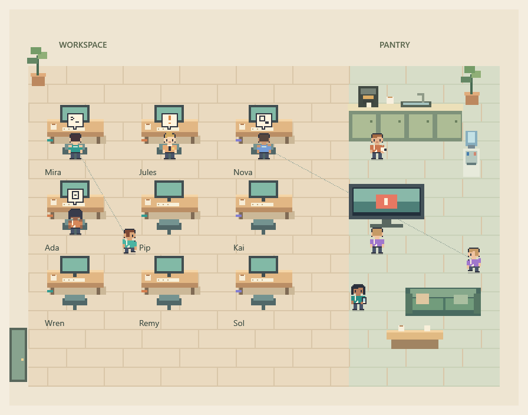
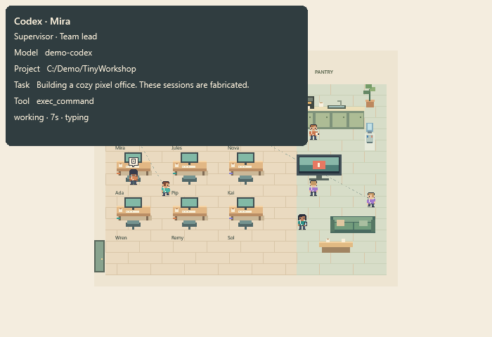

[English](README.md) | [한국어](README.ko.md)

# Vibedotcom

Vibedotcom turns recent local Codex, Claude Code and Antigravity sessions into a small pixel office on Windows. Characters work at desks, wait, deliver reports and take breaks. Hover over one to see its model, project and recent activity; dotted lines show known parent sessions. It observes sessions and does not assign tasks or control agents. This is an independent project, with no affiliation or endorsement from the tool owners.

## Status

Current checkout, reviewed 2026-10-04. Test results below come from recorded reviews, not a new test run.

| Area | Current state |
| --- | --- |
| Tracker and simulation | Implemented; parser, activity and pathfinding tests exist. Antigravity now also reads database snapshots and a local API. |
| WPF app and editor | Implemented, with offscreen checks. Live shell behavior and hands-on editor use remain to be checked. |
| Art and layout | Fixed desks, seated poses, side desks, face lock and prop normalization are integrated. Roster art is still being revised. |
| Windhawk | Compiles; renderer and owned-window tests are recorded. Explorer injection and the manual shell checklist remain open. |
| Release | Local packaging and hash checks exist. Review findings and public-release checks remain open. |

See [limits](docs/limits.md), [app review](docs/review-app.md) and the [release checklist](docs/release-checklist.md).

## Two variants

Both share the .NET 10 tracking core and art pack.

- Standalone: the WPF app reads session sources itself. Windhawk is not required.
- Windhawk: a C++ mod draws inside Explorer using `state.json` from the headless tracker.

The shared file format is documented in the [state contract](docs/state-schema.md).

## Quick start

Use Windows 11 and the .NET 10 SDK. Framework-dependent builds need the .NET 10 Windows Desktop Runtime. The app and tracker have no extra NuGet runtime packages; tests restore into ignored `.packages/`.

```powershell
dotnet build Vibedotcom.sln
dotnet test Vibedotcom.sln --no-build
dotnet run --project src/Vibedotcom.App --no-build
# Invented sessions for a preview or screenshot:
dotnet run --project src/Vibedotcom.App --no-build -- --demo
# Headless tracker for Windhawk; Ctrl+C stops it:
dotnet run --project src/Vibedotcom.Tracker --no-build
```

To edit the office, right-click it and choose **Edit office**. See the [editor guide](docs/editor.md) and [app usage](docs/app-usage.md) for layouts, settings and publishing. The standalone app does not need the headless tracker. For the other variant, follow the [Windhawk setup and manual checks](windhawk/README.md).

Session details can include private paths and prompt text. Read [privacy](docs/privacy.md) before sharing a screenshot or bug report. Unsigned builds are covered in the [Windows security notice](docs/windows-security-notice.md).

## Controls

- Mouse wheel, with or without Ctrl, or `+` / `-`: zoom from 1x to 6x. Drag to pan; hover for session details.
- Right-click the office or tray: fit the office, choose normal/topmost/desktop mode, or change click-through, borders, background and opacity.
- Double-click the tray icon, or choose **Show normal, clickable office**, to recover a clickable window. Closing the app exits and removes its tray icon.

Windhawk has its own settings and no tray. Neither variant appears on the secure lock screen.

## Screenshots

These earlier offscreen renders use only `--demo` data. They do not show every current art revision. Their source and capture command are in [app usage](docs/app-usage.md#screenshots).




TODO in `docs/img/`: refresh the fixed-office/seated view, add an editor view, and capture desktop mode with `--demo` after the manual shell check.

## Documentation

- Use: [App](docs/app-usage.md), [Tracker](docs/tracker.md), [Editor](docs/editor.md), [Privacy](docs/privacy.md), [Windows security](docs/windows-security-notice.md), [Limits and verification](docs/limits.md), [Synthetic-session QA](docs/simulator.md).
- Formats: [State schema](docs/state-schema.md), [Assets and layouts](docs/asset-format.md), [Sources and inference](docs/sources-and-inference.md), [Project specification](SPEC.md).
- Art: [Pipeline and credits](docs/art-pipeline.md), [Face lock](docs/facelock.md), [Seated poses](docs/seated.md), [Prop normalization](docs/anim-normalize.md). The pipeline indexes the production manifests and character notes.
- Windhawk and releases: [Windhawk guide](windhawk/README.md), [Packaging](tools/release/README.md), [Release checklist](docs/release-checklist.md).
- Contribute: [English](CONTRIBUTING.md), [한국어](CONTRIBUTING.ko.md). Legal references: [Trademarks](TRADEMARKS.md), [한국어 요약](TRADEMARKS.ko.md), [Third-party notices](THIRD_PARTY_NOTICES.md).
- Research records: [Antigravity](docs/antigravity-notes.md), [Pixel Agents](docs/pixel-agents-notes.md), [Windhawk](docs/windhawk-notes.md). These describe the code and observations at their recorded dates.
- Review records: [Core and tracker](docs/review-core.md), [App](docs/review-app.md), [Windhawk](docs/review-windhawk.md).

## License

Code is [MIT](LICENSE), copyright (c) 2026 KangDohwa. Project art and assets are [CC BY 4.0](assets/LICENSE.md). The art was generated with an AI image model. Third-party logos and brand icons are excluded; see [trademarks](TRADEMARKS.md) and the [local overlay guide](assets/brand/README.md).
